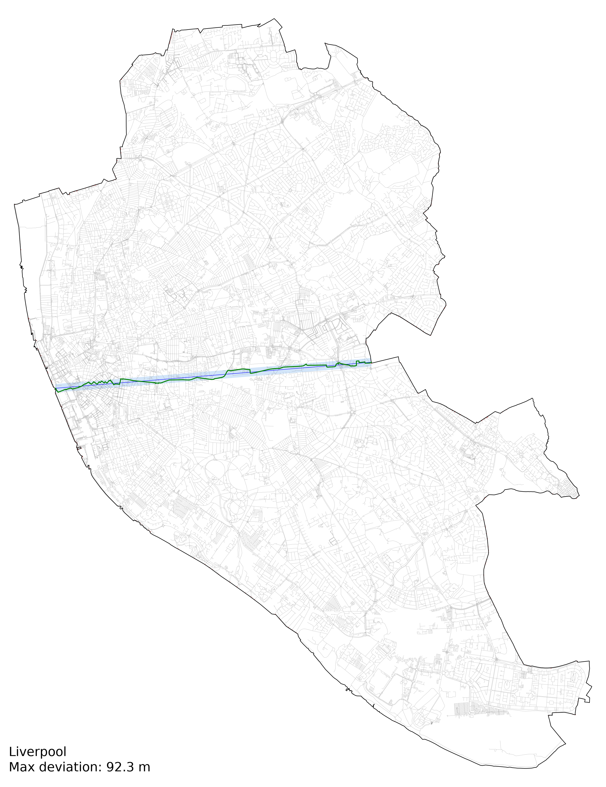

# Straight Line

You may have seen Tom Davies aka Geowizard on YouTube, and his straight line adventures across Wales, Norway and Scotland, or perhaps 
Alastair Stanley's YouTube videos of him straight lining London and Cardiff.

This repository aims to give you a starting point when picking routes similar to Alastair's city straightlines.  It keeps to public
byways (the exact set it adheres to depends on the activity you pick, walking or biking for instance.)  It won't really help with
straight line planning across countryside like Geowizard does.

## Dependencies

- Install [uv](https://docs.astral.sh/uv/), for example with `brew install uv`.
- Run `uv sync` in the repository. uv creates `.venv/` with the packages that `pyproject.toml` lists.

- Get the world's coastline water polygons from https://osmdata.openstreetmap.de/data/water-polygons.html
  - Download the most recent shapefile, the split version, in WGS84 format.  It's about 762MB zipped.
  - Unzip the file, the directory should be called `water-polygons-split-4326`.

## Running

```sh
uv run python run.py <area> <walk|bike>
```

For example, `uv run python run.py liverpool walk` writes `walk-liverpool.png` and `walk-liverpool.gpx`.

The script searches [Nominatim](https://nominatim.openstreetmap.org/) for boundaries with that name.
If more than one boundary matches, the script lists them and asks you to choose one:

```
1. Liverpool, Liverpool City Region, England, United Kingdom  (city, relation 172987)
2. Liverpool, Brazoria County, Texas, 77577, United States  (village, relation 6586792)
...
Choose an area [1]:
```

The area can also be an OSM relation id, such as `172987` or `R172987`. Use the id to run without the question.

| Option | Default | What it does |
|---|---|---|
| `--name` | first part of the area's name | Sets the output name. The files are `<activity>-<name>.png` and `.gpx`. |
| `--min-split` | `0.35` | Sets the smallest fraction of the area that each side of the straight line must have. |
| `--processes` | number of CPUs | Sets the number of search processes. |

Relation ids from earlier runs:

| Area | Relation |
|---|---|
| Whitchurch | 6795460 |
| Crewe | 1410720 |
| Shrewsbury | 4581086 |
| Stoke-on-Trent | 163183 |
| Liverpool | 172987 |
| Manchester | 146656 |
| Cardiff | 1625787 |
| Shropshire | 167060 |
| Greater London | 65606 |
| Wales | 58437 |

## How it works

1. The script gets the area's boundary and the walk or bike network from the Overpass server `overpass-planet.grn.haus`.
   Only the name search uses Nominatim.
2. It removes the sea from the area, and keeps the largest piece of land.
3. It takes the network nodes within 100 m of the boundary as possible start and end points, one per 25 m of boundary.
4. It keeps a pair of points only if the straight line between them stays inside the area and puts at least 35% of the area on each side.
5. For each pair, it finds the route with the smallest deviation. The deviation is the furthest distance in metres between the route and the straight line.
6. It takes the pair with the smallest deviation. Of the routes in that pair's corridor, it takes the shortest.

The search measures the shape of every road, not only its junctions.
Walk routes use every path in both directions.
Bike routes obey one-way streets, except where `oneway:bicycle=no` or `cycleway=opposite*` allows cycling against the traffic.

On an area with more than 2000 possible points, such as a country, the search first uses one point per 1/2000 of the boundary.
It then checks the 25 m points near the best pair. This second pass can miss a better pair elsewhere.

In the PNG, the green line is the route, the blue line is the straight line, and the blue band is the corridor.
The red dots are the possible start and end points.

## Example

This is the straightest route when walking across Liverpool.



## License, copyright, citations

- Citation info: Boeing, G. 2017. "OSMnx: New Methods for Acquiring, Constructing, Analyzing, and Visualizing Complex Street Networks." Computers, Environment and Urban Systems 65, 126-139. doi:10.1016/j.compenvurbsys.2017.05.004

- OpenStreetMap data is copyright OpenStreetMap contributors.  OpenStreetMap® is open data, licensed under the Open Data Commons Open Database License (ODbL) by the OpenStreetMap Foundation (OSMF).
